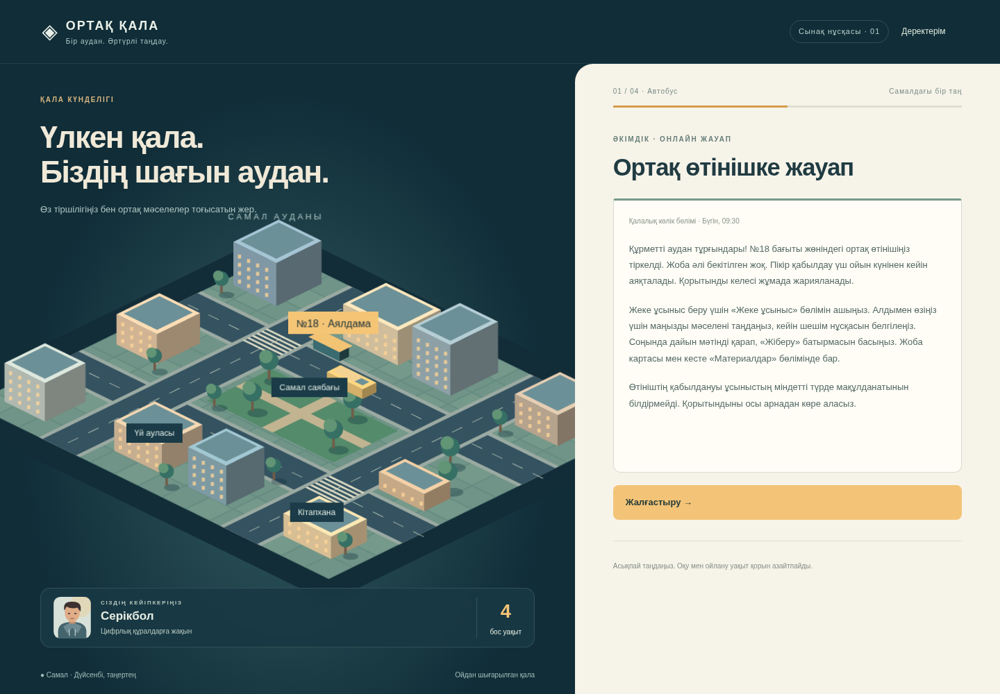

# Ортақ қала — жүктелетін файлдар

Бұл бетте жобаның дайын файлдары берілген. Қазіргі ойын — бірінші автобус эпизодының сынақ прототипі. Қалған үш эпизодтың дизайны бар, бірақ олар әлі ойнатылмайды. Нақты қатысушылармен пилот өткізілген жоқ.

## Соңғы нұсқа · 2026-11-09

- [Ойын прототипі, бастапқы код және іске қосу нұсқаулығы — ZIP](Ortaq-qala-bus-prototype-2026-11-09.zip?raw=true)
- [Экрандар, технология негіздемесі және прототип codebook-ы — Word](Ortaq-qala-prototype-design-2026-11-09.docx?raw=true)
- [Компьютердегі ойын көрінісі](Ortaq-qala-prototype-desktop.png)
- [Телефондағы ойын көрінісі](Ortaq-qala-prototype-mobile.png)

## Негізгі дизайн мен әдіснама · 2026-11-08

- [Дизайн/әдіснама және төрт эпизодтың сценарийі — Word](Ortaq-qala-working-draft-2026-11-08.docx?raw=true)
- [Құжаттар жинағы — ZIP](Ortaq-qala-documentation-2026-11-08.zip?raw=true)

2026-11-09 қосымшасы алдыңғы құжаттағы технология мен іске асыру мәртебесін жаңартады. Бұл материалдар толық дайын қорытынды тапсырылым немесе нақты пилот есебі емес.

## Қалай жүктеуге болады?

Файл атауын басыңыз. Егер GitHub файлды алдын ала көрсетпесе, **Download raw file** (төмен бағытталған жебе) батырмасын пайдаланыңыз. Репозиторий жабық болса, оған рұқсаты бар GitHub аккаунтымен кіріңіз.

ZIP ішіндегі README.md ойынды жергілікті іске қосу жолын түсіндіреді. ZIP жүктеу ойынды автоматты ашпайды; бұл веб-қолданбаға Node.js 24 немесе одан жаңа нұсқа керек. GitHub-қа файлдарды жүктеу ойынды сайт ретінде орналастырумен бірдей емес.

