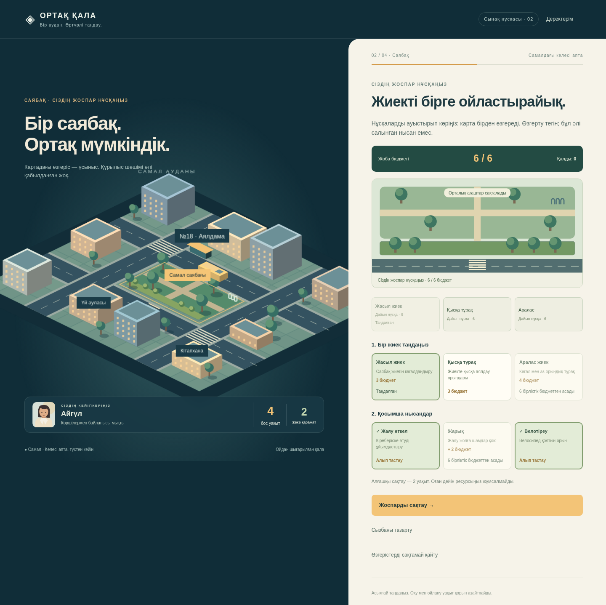

# Ортақ қала — жүктелетін файлдар

Бұл бетте жобаның дайын файлдары берілген. Қазіргі ойын — автобус пен саябақ эпизодтарының 0.2 сынақ прототипі. Аула мен кітапхананың дизайны бар, бірақ олар әлі ойнатылмайды. Нақты қатысушылармен пилот өткізілген жоқ.

## Соңғы нұсқа · 0.2 · 2026-11-10

- [Автобус + саябақ, дайын ойын және бастапқы код — ZIP](Ortaq-qala-bus-park-v0.2-2026-11-10.zip?raw=true)
- [Саябақ механикасы, codebook және жаңарту нұсқаулығы — Word](Ortaq-qala-park-design-v0.2-2026-11-10.docx?raw=true)
- [Саябақ редакторы — компьютер көрінісі](Ortaq-qala-park-desktop-v0.2.png)
- [Саябақ эпизоды — телефон көрінісі](Ortaq-qala-park-mobile-v0.2.png)

Жаңарту: ескі қара терезеде **Ctrl+C** басыңыз; жаңа ZIP-ті бөлек папкаға шығарыңыз. Ішіндегі `ortaq-qala` папкасында `cmd` ашып, **`npm start`** орындаңыз. Дайын жинақ ZIP ішінде бар. Браузерде өз ноутбугыңыздағы `http://localhost:8787` мекенжайын ашыңыз. Жоғарыда «Сынақ нұсқасы · 02» көрінеді. Бұл нұсқада жаңа сынақ сессиясы басталады — автобустан қайта өтіп, саябаққа жалғастырыңыз. Ескі папка мен журналдарды жоймаңыз.

## Алғашқы автобус нұсқасы · архив · 2026-11-09

- [Ойын прототипі, бастапқы код және іске қосу нұсқаулығы — ZIP](Ortaq-qala-bus-prototype-2026-11-09.zip?raw=true)
- [Экрандар, технология негіздемесі және прототип codebook-ы — Word](Ortaq-qala-prototype-design-2026-11-09.docx?raw=true)
- [Компьютердегі ойын көрінісі](Ortaq-qala-prototype-desktop.png)
- [Телефондағы ойын көрінісі](Ortaq-qala-prototype-mobile.png)

## Негізгі дизайн мен әдіснама · 2026-11-08

- [Дизайн/әдіснама және төрт эпизодтың сценарийі — Word](Ortaq-qala-working-draft-2026-11-08.docx?raw=true)
- [Құжаттар жинағы — ZIP](Ortaq-qala-documentation-2026-11-08.zip?raw=true)

2026-11-09 қосымшасы технологияны, ал 2026-11-10 қосымшасы саябақтың іске асырылуын нақтылайды. Бұл материалдар толық дайын қорытынды тапсырылым немесе нақты пилот есебі емес.

## Қалай жүктеуге болады?

Файл атауын басыңыз. Егер GitHub файлды алдын ала көрсетпесе, **Download raw file** (төмен бағытталған жебе) батырмасын пайдаланыңыз. Репозиторий жабық болса, оған рұқсаты бар GitHub аккаунтымен кіріңіз.

ZIP ішіндегі README.md ойынды жергілікті іске қосу жолын түсіндіреді. ZIP жүктеу ойынды автоматты ашпайды; бұл веб-қолданбаға Node.js 24 немесе одан жаңа нұсқа керек. GitHub-қа файлдарды жүктеу ойынды сайт ретінде орналастырумен бірдей емес.

